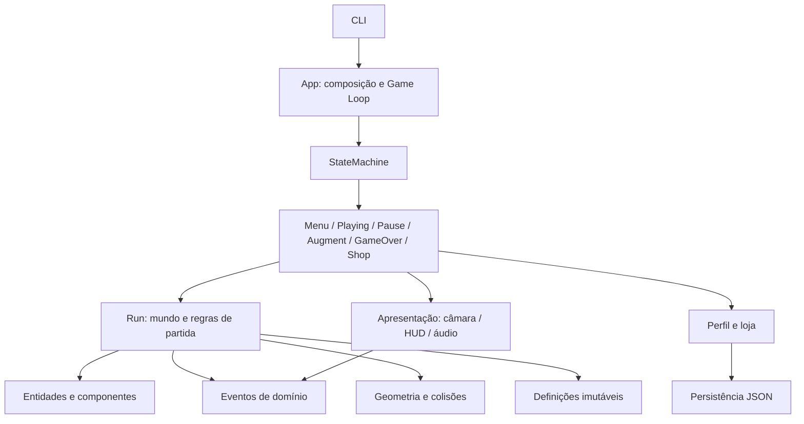
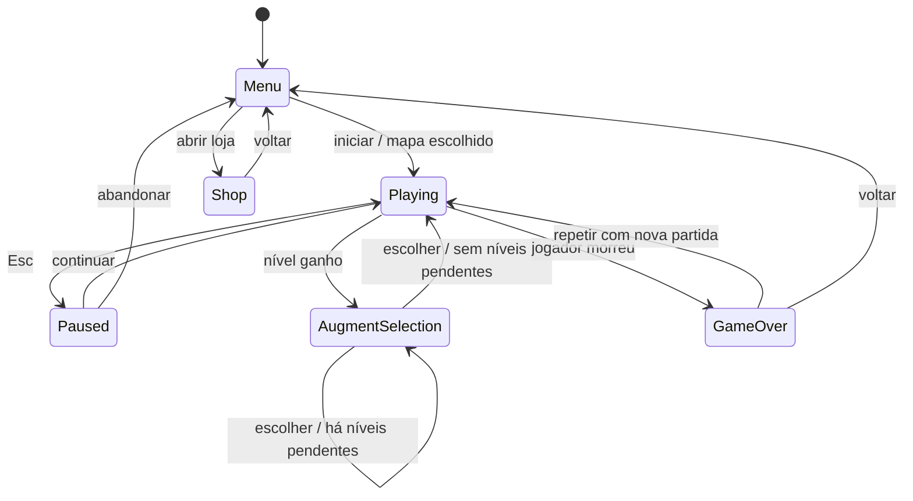

# Arquitetura e padrões de desenho

## Base existente

`App` cria a janela, o relógio e a máquina de estados. Recebe os eventos SDL,
encaminha eventos para o estado atual, atualiza e desenha. Fecha o SDL mesmo
quando há uma exceção. Não contém regras de combate.

`State` define `enter`, `exit`, `handle_event`, `update(dt)` e `draw(surface)`.
Só `StateMachine` substitui o estado atual, executando `exit` antes de `enter`.
O mesmo objeto não volta a entrar ao pedir uma transição para si próprio.
As transições são imediatas; ao criar estados sobrepostos será necessário definir
explicitamente quem recebe input e quem atualiza.

O setup contém apenas `MenuState`. Não há partida, loja ou sistema de augments implementados.
O delta temporal do ecrã inicial é variável e limitado a 100 ms. A simulação de
combate deverá escolher e documentar o seu passo temporal ao ser introduzida.

## Direção de dependências proposta

O diagrama representa responsabilidades futuras, não módulos já existentes.
Input SDL deve ser traduzido antes de entrar nas regras de combate. Geometria
pode usar `pygame.Vector2` e `Rect`, mas não janelas, entidades concretas ou áudio.
Mundo e perfil não devem importar estados de interface.

Criar pacotes como `world`, `entities`, `combat`, `augments`, `progression`,
`persistence` e `presentation` apenas quando houver código com essas responsabilidades.
Evitar uma pasta genérica `managers` que esconda quem é responsável por cada regra.

## Relação com a cadeira

Foram consultados os PDFs locais: `Presentation3` (OOP), `Presentation4 - Patterns`,
`Presentation5 - FSM`, `Presentation6 - Collisions`, `Presentation7 - Event Driven
Programming`, `Presentation9 - Game Engines` e `Presentation10 - AI`; também o
Snake em `alua1` e os módulos `fsm.py`/`collisions.py` do exemplo das formigas.
Os materiais da cadeira não são copiados para este repositório.

| Padrão/técnica | Problema concreto | Situação |
| --- | --- | --- |
| Game Loop | Separar eventos, atualização e desenho. | Implementado em `App`. |
| State / FSM | Trocar comportamento por estado e centralizar transições. | Gestor e menu implementados; estados de partida e IA planeados. |
| Command | Traduzir WASD/Espaço em intenções, sem entidades conhecerem teclas SDL. | Planeado para controlos. |
| Update Method | Atualizar entidades com contrato uniforme e tempo explícito. | Planeado para o mundo. |
| Observer + Event Queue | Uma morte desencadeia XP, ronda, moeda e som sem chamadas cruzadas entre sistemas. | Planeado; publicar e processar são momentos distintos. |
| Component | Combinar vida, arma e efeitos sem uma hierarquia para cada combinação de augments. | Planeado, com componentes pequenos. |
| Type Object | Separar a definição de arma/inimigo/augment do estado de cada instância. | Planeado para catálogos. |
| Flyweight | Partilhar definições e assets imutáveis entre muitos inimigos. | Aplicar ao carregar conteúdo; vida/cooldown nunca partilhados. |
| Broad/narrow phase | Reduzir pares candidatos e confirmar contacto pela geometria apropriada. | Planeado para colisões e mapa infinito. |

Não é necessário implementar todos os padrões dos slides. Prototype, Singleton,
Service Locator e Bytecode não têm, neste momento, um problema que justifique a
sua introdução. Uma fábrica simples de entidades pode ser útil sem constituir
o padrão Factory Method. Composição de efeitos não deve ser automaticamente
descrita como Decorator se não implementar esse contrato.

## Fluxo de uma morte

1. O combate reduz a vida a zero e marca a morte uma única vez.
2. Publica `EnemyKilled` com identificador, origem e recompensas.
3. Uma fila processa os eventos num ponto definido do tick, por ordem documentada.
4. Rondas, XP, moeda de partida e áudio reagem através de subscritores próprios.
5. Se houver level-up, a escolha interrompe a simulação antes do tick seguinte.
6. A morte do jogador tem prioridade sobre abrir uma seleção de augments.

Eventos produzidos durante o despacho precisam de uma política explícita: por
exemplo, ficam para o próximo despacho. Efeitos em cadeia devem ter limites.
Subscritores da partida deixam de existir ao sair; repetir partidas não duplica recompensas.

## Estados propostos

A pausa e a seleção preservam a mesma partida. Uma pilha de estados ou um estado
que guarda a referência anterior são alternativas; a primeira issue exige justificar
a opção. As fases de ronda (`Intermission`, `Spawning`, `Clearing`) e a IA dos
inimigos são máquinas independentes, não estados globais da aplicação.

## Invariantes a validar

- Desenhar não altera o mundo; pausa e escolhas não avançam os seus relógios.
- Uma morte só recompensa uma vez; uma ronda só termina após esgotar o orçamento e os vivos.
- Uma bala normal atinge no máximo um alvo; efeitos de penetração/ricochete têm regras próprias.
- Atributos derivados partem sempre da base + perfil + augments atuais.
- Descartar uma partida elimina efeitos e subscrições dessa partida.
- O mapa infinito mantém memória e entidades ativas limitadas à área relevante.
- O perfil é validado e gravado atomicamente; uma falha de leitura não destrói o ficheiro original.

Os testes devem observar estes contratos. Os algoritmos específicos ficam a cargo
das issues e devem ser escolhidos segundo as formas e medições reais; GJK é uma
opção para formas convexas, não uma obrigação para todas as colisões.
