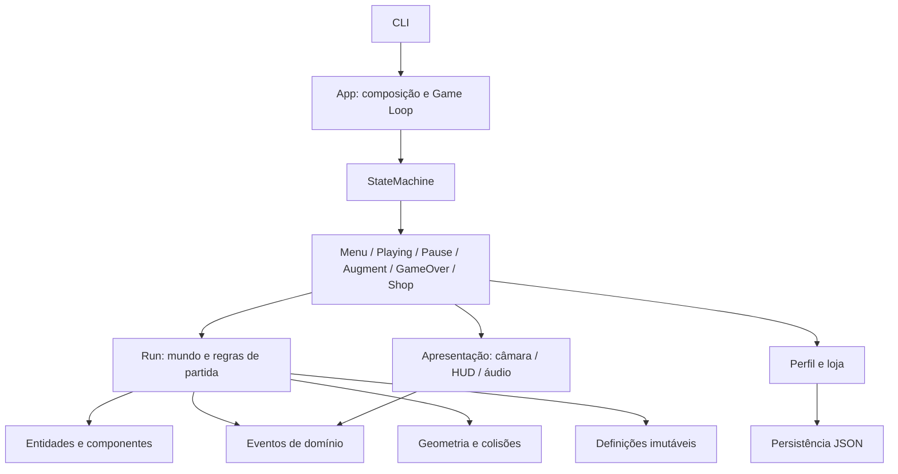
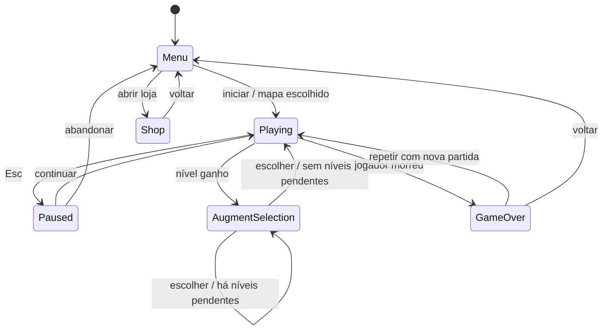

# Arquitetura e padrões de desenho

## Base existente

`App` cria a janela, o relógio e a máquina de estados. Recebe os eventos SDL,
encaminha eventos para o estado atual, atualiza e desenha. Fecha o SDL mesmo
quando há uma exceção. Não contém regras de combate.

`State` define `enter`, `exit`, `handle_event`, `update(dt)` e `draw(surface)`.
Só `StateMachine` substitui o estado atual, executando `exit` antes de `enter`.
O mesmo objeto não volta a entrar ao pedir uma transição para si próprio.
As transições são imediatas; ao criar estados sobrepostos será necessário definir
explicitamente quem recebe input e quem atualiza.

Menu, partida, pausa, game over, loja e seleção estão implementados. Apenas o estado
ativo recebe input e update; pausa e seleção desenham a partida sem a atualizar.
O passo é variável, em segundos, limitado a 100 ms. O relógio continua a ser lido
durante a pausa para não acumular um delta ao retomar.

## Direção de dependências proposta

O diagrama representa responsabilidades futuras, não módulos já existentes.
Input SDL deve ser traduzido antes de entrar nas regras de combate. Geometria
pode usar `pygame.Vector2` e `Rect`, mas não janelas, entidades concretas ou áudio.
Mundo e perfil não devem importar estados de interface.

Criar pacotes como `world`, `entities`, `combat`, `augments`, `progression`,
`persistence` e `presentation` apenas quando houver código com essas responsabilidades.
Evitar uma pasta genérica `managers` que esconda quem é responsável por cada regra.

## Relação com a cadeira

Foram consultados os PDFs locais: `Presentation3` (OOP), `Presentation4 - Patterns`,
`Presentation5 - FSM`, `Presentation6 - Collisions`, `Presentation7 - Event Driven
Programming`, `Presentation9 - Game Engines` e `Presentation10 - AI`; também o
Snake em `alua1` e os módulos `fsm.py`/`collisions.py` do exemplo das formigas.
Os materiais da cadeira não são copiados para este repositório.

| Padrão/técnica | Problema concreto | Situação |
| --- | --- | --- |
| Game Loop | Separar eventos, atualização e desenho. | Implementado em `App`. |
| State / FSM | Trocar comportamento por estado e centralizar transições. | Implementado nos ecrãs e IA; rondas usam estados enumerados. |
| Command | Traduzir WASD/Espaço em intenções, sem entidades conhecerem teclas SDL. | Mensagens de intenção interpretadas pelo mundo/jogador. |
| Update Method | Atualizar entidades com contrato uniforme e tempo explícito. | Implementado no mundo e entidades. |
| Observer + Event Queue | Uma morte desencadeia XP, ronda, moeda e som sem chamadas cruzadas entre sistemas. | Implementado para mortes, XP, rondas e resultados; áudio pendente. |
| Component | Combinar vida, arma e efeitos sem uma hierarquia para cada combinação de augments. | Composição de atributos e comportamentos; sem framework ECS. |
| Type Object | Separar a definição de arma/inimigo/augment do estado de cada instância. | Definições de armas, inimigos e augments implementadas. |
| Flyweight | Partilhar definições e assets imutáveis entre muitos inimigos. | Frames partilhados; vida, cooldown e animação são por instância. |
| Broad/narrow phase | Reduzir pares candidatos e confirmar contacto pela geometria apropriada. | Grelha e geometria implementadas; mapa infinito pendente. |

Não é necessário implementar todos os padrões dos slides. Prototype, Singleton,
Service Locator e Bytecode não têm, neste momento, um problema que justifique a
sua introdução. Uma fábrica simples de entidades pode ser útil sem constituir
o padrão Factory Method. Composição de efeitos não deve ser automaticamente
descrita como Decorator se não implementar esse contrato.

## Fluxo de uma morte

1. O combate reduz a vida a zero e marca a morte uma única vez.
2. Publica `EnemyKilled` com identificador e recompensas.
3. Uma fila processa os eventos num ponto definido do tick, por ordem documentada.
4. XP e moeda reagem por subscritores; o diretor consulta os vivos. Áudio pendente.
5. Se houver level-up, a escolha interrompe a simulação antes do tick seguinte.
6. A morte do jogador tem prioridade sobre abrir uma seleção de augments.

Eventos produzidos durante o despacho ficam para a geração seguinte do mesmo
despacho, com limite de profundidade. Efeitos em cadeia têm limites próprios.
Subscritores da partida deixam de existir ao sair; repetir partidas não duplica recompensas.

## Estados propostos

A pausa e a seleção preservam a mesma partida. Uma pilha de estados ou um estado
que guarda a referência anterior são alternativas; a primeira issue exige justificar
a opção. As fases de ronda (`Intermission`, `Spawning`, `Clearing`) e a IA dos
inimigos são máquinas independentes, não estados globais da aplicação.

## Invariantes a validar

- Desenhar não altera o mundo; pausa e escolhas não avançam os seus relógios.
- Uma morte só recompensa uma vez; uma ronda só termina após esgotar o orçamento e os vivos.
- Uma bala normal atinge no máximo um alvo; efeitos de penetração/ricochete têm regras próprias.
- Atributos derivados partem sempre da base + perfil + augments atuais.
- Descartar uma partida elimina efeitos e subscrições dessa partida.
- O mapa infinito mantém memória e entidades ativas limitadas à área relevante.
- O perfil é validado e gravado atomicamente; uma falha de leitura não destrói o ficheiro original.

Estes contratos orientam a implementação e a verificação manual durante o jogo.
Os algoritmos específicos ficam a cargo das issues e devem ser escolhidos segundo
as formas e necessidades reais; GJK é uma
opção para formas convexas, não uma obrigação para todas as colisões.

## Implementação: colisões, eventos, resultados e sprites

- `core/geometry.py` inclui tangência nos contactos e separa deteção de resposta.
  Projéteis usam percurso varrido com o seu raio: círculo/círculo e soma de Minkowski
  com faixas/cantos circulares para AABBs. Coordenadas float, sem tolerância extra;
  objetos móveis além dos projéteis continuam a usar contactos discretos.
- `World` coordena a simulação. Eventos são publicados durante o tick e despachados
  por gerações depois dele; eventos produzidos no despacho são processados na geração
  seguinte, no mesmo despacho, com limite de 32 gerações. `PlayerDied` é emitido uma
  vez; `RoundCompleted` mantém `RoundEnded` como alias de compatibilidade.
- `RunResult` é um snapshot imutável com UUID, motivo (death/abandoned/quit), ronda,
  mortes, nível, XP efetivo total, moeda e tempo de simulação. `World.finish()` é
  idempotente e publica `RunFinished` uma única vez. A morte tem prioridade sobre
  abrir uma seleção de augments.
- `ProfileStore.commit()` guarda uma cópia antes de publicar o estado em memória.
  Compras usam esse caminho; recompensas guardam também os IDs das partidas creditadas.
  Se a escrita falhar, os resultados ficam pendentes na aplicação, com aviso e nova
  tentativa no menu, nova partida e saída. Se o processo terminar sem nunca conseguir
  escrever, as recompensas pendentes em memória não sobrevivem ao reinício.
- `presentation/HUD` lê os modelos sem os alterar. `SpritePainter` prepara frames e
  cacheia transformações; os assets do bundle e o manifest também acompanham o wheel.
  Os adaptadores existentes ainda usam o catálogo global; passar essa dependência
  explicitamente permanece uma melhoria opcional.

## Armas, rondas e escolha de augments

`World.apply(Shoot)` pede a autorização a `Player.try_fire`, que consome o cooldown
uma só vez. O resultado booleano é usado pelo adaptador visual. Definições de armas
são imutáveis e validadas; o estado temporal permanece por instância de jogador.

`RoundDirector` gere orçamento e fases; `World.can_spawn_at` verifica geometria e
ocupação. Um spawn adiado não consome orçamento. As curvas e limites de carga estão
em `RoundConfig`; o número de rondas é independente do limite de ativos/orçamento.

O catálogo valida IDs, alvos, efeitos, limites e grafo de dependências. A oferta é
um valor imutável cacheado em `World`; o estado das cartas apenas o apresenta. Só
um augment dessa oferta pode ser adquirido. O domínio recalcula os modificadores;
a interface gere foco, teclas mantidas, confirmação única e pausa.
